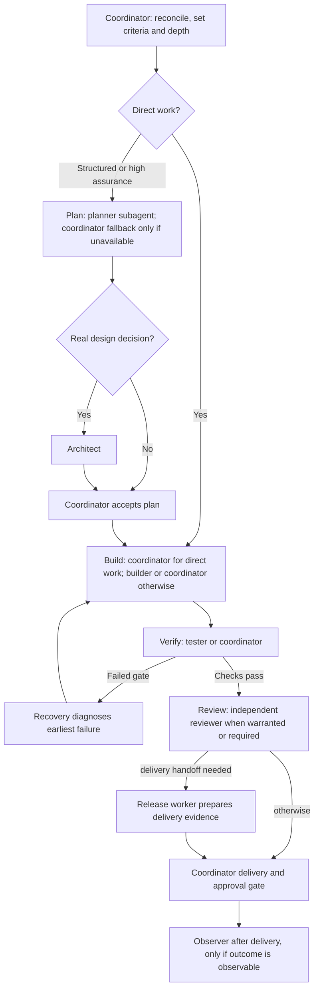

# Integrated task workflow

This is the orchestration contract for the product. The coordinator owns one task record, the acceptance criteria, stage decisions and final handoff. Agent roles are bounded workers; specialist skills are just-in-time methods. Both return into the same workflow. Neither starts a competing lifecycle.

## Select execution depth

Use the smallest mode that covers the task's real risk. See [stage contracts](STAGE_CONTRACTS.md) for stage-specific gates.

| Mode | Use when | Operating shape |
|---|---|---|
| Direct | A localized, reversible change with clear intent | Work in the current agent; keep intent and acceptance evidence inline; run the most relevant check and inspect the diff. No standalone plan or subagent by default. |
| Structured | Multiple steps, dependencies, files or acceptance criteria | Dispatch a planner in the native thread; accept one dependency-aware plan; split implementation into bounded units and delegate eligible builders. |
| High assurance | Auth, security, data integrity, destructive actions, migrations, payments, public interfaces or consequential agent autonomy | Use native planner handoff; add written design and rollback; require separate tester/reviewer handoffs when supported, negative/compatibility checks and explicit human approval gates. |

For long-running, background or self-modifying agents, also define locked policies/evaluators, a narrow editable surface, durable append-only results, bounded time/cost/retries, rollback and human-controlled promotion. Route to `harness-engineering` as shown in [skill routing](SKILL_ROUTING.md) when that capability is available and relevant.

## Codex subagent availability

Codex supports native subagent threads in the current session and can spawn them when an applicable skill instruction calls for delegation. Dispatch through those native orchestration actions and wait/message as needed; do not emulate a subagent by launching a separate `codex exec` process. Custom-agent TOML files provide reusable role instructions and are loaded from `$CODEX_HOME/agents` (default `~/.codex/agents`) or project `.codex/agents`. Install these optional role files with `scripts/install.py --scope user --roles` or `--scope project --project PATH --roles`; their absence does not prevent native delegation, since the coordinator can give an available native agent a bounded role prompt. Codex's `[agents].enabled` setting controls native delegation and defaults to enabled. If delegation is disabled or unavailable, do the stages in the coordinator and state that no subagent ran. Do not change a user's Codex configuration just to enable delegation. See the [Codex subagents documentation](https://developers.openai.com/codex/subagents/) for current paths and settings.

Agent instructions are behavioral constraints, not access controls. Codex subagents inherit the parent session's sandbox, approval policy and tools. Use parent-session permissions for enforcement, keep delegated write scopes disjoint (prefer separate worktrees for parallel writers), and have the coordinator inspect the integrated diff. A role labelled “read-only” must not be treated as OS-enforced read-only access.

Use the following dispatch triggers to choose the team shape. Direct work stays inline. For every Structured or High assurance task, use a planner subagent to map criteria, dependencies and implementation units; use a builder subagent for each accepted implementation unit with a bounded, non-overlapping scope. High assurance work uses separate tester and reviewer subagents when native delegation is available. Other roles follow their specific trigger below.

| Role | Dispatch when | Keep inline / skip when |
|---|---|---|
| `planner` | Every Structured or High assurance task | One clear, localized Direct task |
| `architect` | A public/interface boundary, cross-module design, migration/data model, security boundary or agent harness decision could change the implementation | Existing interfaces make the path clear |
| `builder` | Each accepted implementation work unit in Structured/High assurance work; parallel builders only for independent units | A Direct task, or no implementation work is required |
| `tester` | Implementation was delegated, multiple criteria need mapped evidence, or risk calls for independent verification; required for High assurance when available | A Direct task has one simple check the coordinator can run and inspect |
| `reviewer` | Required for High assurance when available; otherwise use for consequential boundary changes or a distinct independent critique | Tiny low-risk change with no useful independent review angle |
| `release` | An authorized merge/deploy/release is in scope and needs a distinct readiness handoff, such as CI/policy review, release notes, compatibility checks or rollback preparation | No delivery stage is in scope, or the coordinator can satisfy the documented gate without a separate handoff |
| `recovery` | A stage gate fails or a transition is blocked by a concrete tool/environment error | No failure has occurred; never dispatch as routine ceremony |
| `observer` | An authorized delivery has an available, relevant outcome signal | Nothing was delivered or the outcome cannot be inspected |

For high-assurance work, seek independent verification and review even when this requires a separate handoff. A user's approval and repository policy remain controlling gates.

### Dispatch, wait and integrate

1. The coordinator creates one task contract and sends the planner the intent, current revision, constraints and request for criterion IDs, dependencies and a bounded plan.
2. The coordinator waits for the planner, reconciles the result with repository evidence and accepts or corrects the plan before dispatching implementation.
3. The coordinator sends each builder only its accepted AC IDs, owned paths, read/write scope, dependencies and stop condition. Dispatch builders in parallel only for disjoint work; otherwise wait and sequence them.
4. After integration, record the exact head and run required checks. Dispatch the tester and then reviewer as separate native subagent threads when triggered; give each the same exact revision and return path. Verify the revision again after each handoff because role instructions do not technically prevent writes.
5. After review findings are resolved, dispatch `release` when the delivery trigger applies. Give it the exact revision and available CI/policy evidence; receive a readiness report with release notes, compatibility or migration risks, rollback steps and unresolved approvals. The release worker does not approve, merge or deploy.
6. On any failed gate, send the earliest failure, exact command/output, revision and affected criteria to recovery. Wait for diagnosis, assign any bounded fix, then rerun failed and invalidated checks before advancing.
7. Only the coordinator synthesizes results, updates shared progress, resolves conflicts and advances or closes the task. It waits for every required subagent result; a worker's self-reported PASS never closes a gate. The coordinator checks authorization and repository policy before performing the explicitly authorized delivery action.

Do not spawn every role for every task. Choose the smallest team that satisfies these defaults; when a custom role is missing, put the role contract in the native subagent assignment rather than silently turning delegation into a separate process.

## Stage handoff

The coordinator owns every gate and uses the dispatch triggers above; its task contract and criterion-to-evidence map remain the shared source of truth.

## Run one gated workflow

1. **Reconcile and frame.** Read repository policy, current issue/PR, branch, checks and existing progress. Confirm authorization, baseline, scope and definition of done. Preserve existing user-authored progress.
2. **Plan once.** For Structured and High assurance work, dispatch a `planner` subagent to map criteria into dependency-aware work units; wait, reconcile its proposal and accept one plan. Use `architect` only for an actual interface, migration, cross-module or harness decision.
3. **Compose relevant capabilities.** Inventory installed skills once. Select a role or skill only for a concrete gap and give it the relevant criterion IDs, scope, constraints, inputs, expected output and stop condition. Native Codex subagents inherit skills from their parent unless configured otherwise; pass task-specific pointers when useful, and explicitly hand off findings that exist only in a sibling's context. See [skill routing](SKILL_ROUTING.md). Do not ask specialists to repeat the full lifecycle or produce duplicate plans.
4. **Build in slices.** Assign a `builder` only a bounded work unit with accepted criteria and disjoint write ownership. Prefer existing interfaces and small, testable changes. Keep security, compatibility and user constraints attached to each unit.
5. **Verify and review the same revision.** A `tester` checks criteria against the exact changed head when triggered by the dispatch table, and is required for High assurance when delegation is available. A `reviewer` checks intent, diff and evidence independently; this handoff is required for High assurance when delegation is available and otherwise follows the dispatch table. The coordinator integrates findings and alone decides status. On failure, use `recovery` to diagnose the first failed gate, assign a bounded fix, then rerun the failed and invalidated checks; do not restart the whole workflow.
6. **Prepare release and deliver.** When the dispatch trigger applies, a `release` worker prepares a revision-specific readiness report, release summary and rollback checklist. The coordinator checks CI, permissions, approvals and branch policy, then performs only the authorized delivery action.
7. **Observe.** Use `observer` only when a delivered outcome can actually be inspected. Report UNKNOWN when it cannot.

Stages not required by the selected mode may stay inside the coordinator when a role adds no value. If delegation is unavailable or disabled, perform the same gates inline and record that no subagent ran. Do not dispatch a fixed chain for Direct tasks; every required acceptance criterion still needs evidence.

## Handoff contract

Each delegated assignment states:

- task ID and relevant acceptance-criterion IDs;
- current stage, source revision and bounded scope;
- read/write authority, dependencies and constraints;
- one concrete question or deliverable and a stop condition.

Each worker returns a concise result with evidence and limitations, changed files or commands when relevant, criterion impact, blockers/risks and one next action. Only the coordinator dispatches children, updates shared progress, changes acceptance status, resolves scope changes or advances a stage; workers return to the coordinator instead of creating nested agents. Parallel writers need disjoint files/worktrees and an integration owner; otherwise work sequentially.

## Efficiency and stop rules

- Keep one task contract, one source of truth for progress and one criterion-to-evidence map. Use existing issue/PR fields before creating another artifact.
- Load a reference or skill only when its trigger applies. Reuse one specialist across related criteria; add another only for a distinct gap.
- Skip formal artifacts, agent calls, full audits and repeated checks when they do not improve the evidence for a direct task.
- Preserve failed attempts only when useful for diagnosis or resume; retry idempotent actions within a bounded budget and never repeat non-idempotent actions blindly.
- Stop when required criteria are verified on the reviewed head, blocking findings are resolved, and remaining human or external gates are clearly handed off.

For durable status and resume rules, use [task progress protocol](TASK_PROGRESS_PROTOCOL.md). For check selection, evidence and review severity, use [quality protocol](QUALITY_PROTOCOL.md). For failed gates, use [recovery matrix](RECOVERY_MATRIX.md).
